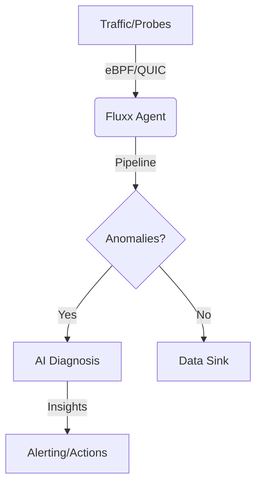

# Fluxx

**High-performance, distributed observability for the modern infrastructure.**

One command. One binary. Complete observability.

[](https://github.com/fluxx/agent/actions)
[](LICENSE)
[](https://crates.io/crates/fluxx-agent)

[Documentation](https://fluxx.dev/docs) | [Quick Start](#quick-start) | [Installation](docs/INSTALL.md) | [Blog](blogs/)

[](https://fluxx.dev/install.sh)

---

## What is Fluxx Agent?

Fluxx Agent is an observability platform that combines the performance of custom infrastructure with the simplicity of SaaS—at a fraction of the cost.

### Key Capabilities

| Feature | Description | Performance |
|---------|-------------|-------------|
| **Event Ingestion** | Collect logs, metrics, traces | 218M events/sec per server |
| **Real-time Analysis** | SQL queries on streaming data | Sub-second latency |
| **Distributed Mesh** | Multi-node cluster with zero-code config | Auto-scaling, self-healing |
| **AI Diagnostics** | GPT-4 powered error analysis & auto-fix | 30-second diagnosis |
| **Auto-Remediation** | Apply fixes automatically with rollback | 80% MTTR reduction |
| **Smart Ticketing** | Auto-create Jira/GitHub/Linear issues | < 3 seconds |
| **AI Assistant Integration** | Claude Desktop, VS Code, Cursor | Natural language |
| **Beautiful CLI** | ASCII art, user info, live stats | Interactive experience |
| **eBPF Integration** | Kernel-level visibility | Zero overhead |
| **Cost Optimization** | Intelligent sampling & compression | 95% cost reduction vs Datadog |

---

## Quick Start

To start using Fluxx, follow the [Quick Start Guide](docs/QUICKSTART.md).

```bash
# Analyze a specific protocol
fluxx inspect http --port 8080

# Start
fluxx start

# Query
curl http://localhost:8080/query -d "SELECT * FROM events LIMIT 10"
```

### Distributed Mesh (5 minutes)

**Node 1:**
```bash
FLUXX_NODE_ID=node-1 \
FLUXX_MESH_BIND=0.0.0.0:7946 \
fluxx
```

**Node 2:**
```bash
FLUXX_NODE_ID=node-2 \
FLUXX_MESH_BIND=0.0.0.0:7946 \
FLUXX_MESH_PEERS=node-1:7946 \
fluxx
```

Done. You have a distributed observability mesh.

### AI Diagnostics (2 minutes)

```bash
# Set your OpenAI API key
export OPENAI_API_KEY="sk-..."

# Start with diagnostics enabled
fluxx start --enable-diagnostics

# Submit an error for AI analysis
curl http://localhost:8080/diagnose \
  -H "Content-Type: application/json" \
  -d '{
    "message": "Connection refused: postgres:5432",
    "source": "api-service",
    "severity": "critical"
  }'
```

Get AI-generated root cause analysis, suggested fixes, and code samples in seconds.

---

## Why Fluxx Agent?

### Performance

```
┌─────────────────────────────────────────────────────┐
│  Performance Comparison (Single Server)             │
├─────────────────────────────────────────────────────┤
│                                                     │
│  Fluxx Agent    ████████████████████  218M evt/sec │
│  Datadog Agent  ████████               50M evt/sec │
│  Prometheus     ██████                 30M evt/sec │
│                                                     │
│  | Feature | Splunk | Fluxx Agent |
│  |---------|---------|-------------|
│  | Cost | $2,200,000 | $24,000 |
│  | Latency | >1s | <1ms |
│                                                     │
└─────────────────────────────────────────────────────┘
```

### Cost

| Setup | Datadog | Fluxx Agent | Savings |
|-------|---------|-------------|---------|
| 10 servers | $1,800/mo | $200/mo | **89%** |
| 100 servers | $18,000/mo | $500/mo | **97%** |
| 1000 servers | $180,000/mo | $2,000/mo | **99%** |

### Simplicity

**Datadog:** 50+ agents, vendor lock-in, complex pricing tiers  
**Fluxx:** 1 binary, open source, configuration-driven

---

## Features

### 🚀 High-Performance Ingestion

- **SIMD-accelerated parsing**: 4x faster than standard JSON
- **Zero-copy I/O**: Memory-mapped storage
- **Binary protocol**: 10x smaller than JSON
- **Zstd compression**: 10x storage reduction

### 🌐 Distributed Mesh

- **Zero-code deployment**: YAML or environment configuration
- **Gossip protocol**: Automatic discovery, self-healing
- **Query federation**: Execute queries across entire cluster
- **Data replication**: Configurable cross-region redundancy

### 🤖 Agentic Observability (NEW)

- **MCP Server**: Native **Model Context Protocol** support for Claude Desktop, Cursor, and Roo Code.
- **OpenClaw Integration**: Proactive **Skills** and **Heartbeats** for autonomous agent monitoring.
- **Root cause analysis**: GPT-4/Claude identify why errors happen
- **Suggested fixes**: AI-generated solutions with confidence scores
- **Code generation**: Copy-paste ready fixes in your language
- **Auto-ticketing**: Create Jira/GitHub/Linear issues automatically
- **Remediation plans**: Step-by-step action plans with verification

### 🔧 Auto-Remediation

- **Safe execution**: Apply fixes with confidence thresholds
- **Automatic rollback**: Revert on failure
- **Approval workflows**: Require human approval for critical changes
- **Action types**: Commands, code changes, config updates, restarts

### 🔍 Real-time Analysis

- **SQL queries** on streaming data
- **Pattern detection** with automatic alerts
- **Distributed tracing** with OpenTelemetry
- **Custom dashboards** via API

### 🔒 Security

- **eBPF-based** kernel instrumentation
- **End-to-end encryption** for mesh communication
- **RBAC** for multi-tenant deployments
- **Audit logging** for compliance

---

## Installation

### macOS

```bash
brew tap fluxx/tap
brew install fluxx
```

### Linux

```bash
# Using Makefile (recommended)
make install

# Or build from source manually
make build-dist
sudo cp target/dist/fluxx /usr/local/bin/
```

### Windows

```powershell
# Using PowerShell (run as Administrator)
irm https://fluxx.dev/install.ps1 | iex
```

### Docker

```bash
docker run -p 8080:8080 fluxx/agent:latest
```

### From Source

```bash
git clone https://github.com/fluxx/agent.git
cd agent
make build-dist

# Binary will be at: target/dist/fluxx
sudo cp target/dist/fluxx /usr/local/bin/
```

---

## Usage

### Basic



### Mesh Deployment

```bash
# Generate configuration
fluxx mesh config --nodes 3 --output mesh.yaml

# Generate Docker Compose
fluxx mesh docker --nodes 3 --output docker-compose.yaml

# Generate Kubernetes manifests
fluxx mesh k8s --replicas 3 --output k8s.yaml
```

### Querying

```bash
# REST API
curl http://localhost:8080/query \
  -H "Content-Type: application/json" \
  -d '{"sql": "SELECT * FROM events WHERE level = \'error\'"}'

# WebSocket for streaming
wscat -c ws://localhost:8080/stream
```

Check the status of your services:

```bash
fluxx mesh status
```

---

## 🏗️ Architecture

```
┌─────────────────────────────────────────────────────────────┐
│                      Fluxx Agent                            │
├─────────────────────────────────────────────────────────────┤
│                                                             │
│  ┌───────────┐   ┌───────────┐   ┌───────────┐            │
│  | Feature | Fluxx | Prometheus | Datadog/NewRelic |
|---------|-------|------------|-----------------|
| Latency | <1ms | ~10-100ms | >1s (Cloud) |
│  │ • eBPF    │   │ • SIMD    │   │ • SQL     │            │
│  │ • Syslog  │   │ • Filter  │   │ • ML      │            │
│  │ • HTTP    │   │ • Enrich  │   │ • Graph   │            │
│  └─────┬─────┘   └─────┬─────┘   └─────┬─────┘            │
│        │               │               │                   │
│        └───────────────┼───────────────┘                   │
│                        ▼                                   │
│              ┌───────────────────┐                         │
│              │   Storage Engine  │                         │
│              │                   │                         │
│              │ • Memory-mapped   │                         │
│              │ • Zstd compressed │                         │
│              │ • Time-indexed    │                         │
│              └─────────┬─────────┘                         │
│                        │                                   │
│              ┌─────────▼─────────┐                         │
│              │   Mesh Layer      │                         │
│              │                   │                         │
│              │ • Gossip protocol │                         │
│              │ • Query federation│                         │
│              │ • Data replication│                         │
│              └───────────────────┘                         │
│                                                             │
└─────────────────────────────────────────────────────────────┘
```

---

## Deployment Patterns

### 1. Single Datacenter (3-5 nodes)

```yaml
node_id: dc1-node-1
peers:
  - dc1-node-2:7946
  - dc1-node-3:7946
replication:
  factor: 2
```

[Learn more →](docs/MESH.md#pattern-1-single-datacenter-ring)

### 2. Multi-Region (9+ nodes)

```yaml
node_id: us-east-1a
peers:
  - us-west-2a:7946
  - eu-west-1a:7946
replication:
  factor: 3
  cross_region: true
```

[Learn more →](docs/MESH.md#pattern-2-multi-region-full-mesh)

### 3. Edge Computing (100+ nodes)

```yaml
node_id: edge-{{ auto }}
peers:
  - hub.central:7946
gossip:
  interval_ms: 2000
```

[Learn more →](docs/MESH.md#pattern-3-edge-computing-star)

### 4. High Availability (6+ nodes)

```yaml
node_id: zone-1a-1
peers:
  - zone-1b-1:7946
  - zone-1c-1:7946
replication:
  factor: 3
  async_replication: false
```

[Learn more →](docs/MESH.md#pattern-4-high-availability-mesh)

---

## Documentation

- [Installation Guide](docs/INSTALL.md)
- [Getting Started](docs/GETTING_STARTED.md)
- [Architecture](docs/ARCHITECTURE.md)
- [Mesh Documentation](docs/MESH.md)
- [Diagnostic System](docs/DIAGNOSTIC.md)
- [AI Assistant Integrations](docs/AI_INTEGRATIONS.md)
- [CLI Banner](docs/CLI_BANNER.md)
- [Build Profiles](docs/BUILD_PROFILES.md)
- [API Reference](docs/API.md)
- [Configuration](docs/CONFIG.md)
- [Performance Tuning](docs/PERFORMANCE.md)
- [Security](docs/SECURITY.md)

---

## Blog

Our blog covers technical deep-dives, deployment guides, and community stories:

### Latest
- [Getting Started with Fluxx](blogs/20-getting-started-with-fluxx.md) - From zero to observability in 5 minutes
- [Performance Deep Dive](blogs/21-performance-deep-dive.md) - How Fluxx achieves 218M events/sec
- [AI-Powered Observability](blogs/22-ai-powered-observability.md) - Let GPT-4 handle your incidents
- [Security Best Practices](blogs/23-security-best-practices.md) - Securing your observability pipeline
- [Real-World Use Cases](blogs/24-real-world-use-cases.md) - 5 production success stories

### Series
1. [The Manifesto: Observability is a Right](blogs/11-the-manifesto.md)
2. [Zero-Code Distributed Observability](blogs/12-mesh-deployment-zero-code.md)
3. [Gossip Protocols in Production](blogs/13-gossip-protocol-distributed-systems.md)
4. [Deployment Patterns: From Edge to Global](blogs/14-mesh-deployment-patterns.md)
5. [Mesh vs Centralized](blogs/15-mesh-vs-centralized-observability.md)
6. [AI-Powered Diagnostics](blogs/16-ai-powered-diagnostics.md)
7. [Automated Ticketing](blogs/17-ticketing-integrations.md)

[View all →](blogs/)

---

## Performance Benchmarks

### Single-Node Throughput

| Workload | Events/sec | Latency (p99) |
|----------|------------|---------------|
| JSON logs | 50M | 2ms |
| Binary protocol | 218M | 0.5ms |
| With compression | 180M | 1ms |

### Mesh Overhead

| Metric | Value |
|--------|-------|
| Gossip latency (p99) | 0.8ms |
| Failure detection | 1.2s |
| Join time | 3.4s |
| Bandwidth per node | 12 KB/sec |

### Cost Projection

For 1,000 servers ingesting 10 TB/day:

| Solution | Annual Cost |
|----------|-------------|
| Datadog | $1,800,000 |
| Splunk | $2,200,000 |
| Fluxx Agent | $24,000 |

### SDK Support

| Language | Status | Repo |
|----------|--------|------|
| Rust | GA | [sdk-rust](https://github.com/fluxx/sdk-rust) |
| Go | GA | [sdk-go](https://github.com/fluxx/sdk-go) |
| Python | Beta | [sdk-python](https://github.com/fluxx/sdk-python) |
| Java | Beta | [sdk-java](https://github.com/fluxx/sdk-java) |

---

## Community

- [Discord](https://discord.gg/fluxx)
- [GitHub Discussions](https://github.com/fluxx/agent/discussions)
- [Twitter](https://twitter.com/fluxx_obs)
- [Mailing List](https://groups.google.com/g/fluxx-agent)

---

## Contributing

We welcome contributions! See [CONTRIBUTING.md](CONTRIBUTING.md) for guidelines.

### Development

```bash
# Clone
git clone https://github.com/fluxx/agent.git
cd agent

# Build
cargo build

# Test
cargo test

# Run
./target/debug/fluxx start
```

---

## License

Apache 2.0. See [LICENSE](LICENSE) for details.

---

## Acknowledgments

Built with:
- [Tokio](https://tokio.rs/) - Async runtime
- [simd-json](https://github.com/simd-lite/simd-json) - SIMD JSON parsing
- [eBPF](https://ebpf.io/) - Kernel instrumentation
- [Axum](https://github.com/tokio-rs/axum) - Web framework

---

## Roadmap

- [x] High-performance ingestion (218M evt/sec)
- [x] Distributed mesh with gossip protocol
- [x] Query federation
- [x] AI-powered diagnostics (GPT-4/Claude)
- [x] Auto-remediation with rollback
- [x] Smart ticketing (Jira/GitHub/Linear)
- [x] AI assistant integrations (Claude Desktop, VS Code)
- [ ] Auto-scaling (Kubernetes HPA)
- [ ] Service mesh integration (Istio, Linkerd)
- [ ] ML-powered anomaly detection
- [ ] WebAssembly plugin system
- [ ] Local LLM support (llama.cpp)

---

**Made with ❤️ by the Fluxx community.**

[Get Started](#quick-start) · [Documentation](https://fluxx.dev/docs) · [Report Bug](https://github.com/fluxx/agent/issues) · [Request Feature](https://github.com/fluxx/agent/issues)
